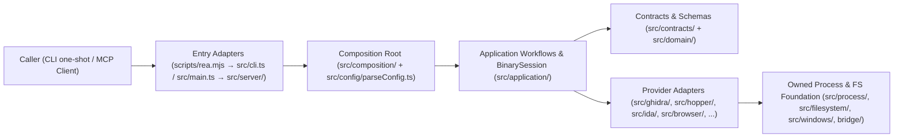

# PROJECT SUMMARY — REA (Reverse Engineer Anything)

**Last Updated:** 2026-11-07 · **Session:** 3 · **Setup baseline:** 2026-11-03

> File này phản ánh **trạng thái hiện tại** của dự án `REA` (`rea-agents`). Không dùng làm changelog hay bug-fix log — lỗi quan trọng thì ghi vào `.claude/IMPORTANT_FIXED_BUGS.md` (khi lập theo §0.5); lỗi vặt thì không ghi đâu cả.

**Cập nhật sau MỌI task đụng tới dự án này:**

- dòng `Last Updated` + số session — **luôn**
- bảng Trạng thái: đổi ⏳ → 🚧 → ✅ nếu có thay đổi
- `Known Issues & TODOs`: mục đã xong thì **xoá** (không tick `[x]` rồi để đó — git giữ lịch sử); nó để lại cơ chế / quyết định còn hiệu lực thì ghi vào `DESIGN_DECISIONS.md` trước khi xoá. Thêm mục mới nếu có
- `Cấu trúc file` / `Phụ thuộc`: chỉ khi có file/dependency mới

**Giữ gọn (file này nạp mỗi session):** ô `Ghi chú` của dòng ✅ chỉ nói _cái gì_ trong một câu ngắn, không kể từng nút/màu. _Cơ chế + vì sao_ ⇒ `DESIGN_DECISIONS.md`; bẫy ⇒ `IMPORTANT_FIXED_BUGS.md`; chi tiết UI ⇒ không ghi (code + git đã có). Ngưỡng dung lượng tối đa của file này là **23,500 bytes** (cao hơn kích thước hiện tại ~8%, dưới trần 30,000 bytes) — vượt ngưỡng phải dọn trước khi thêm.

Không tồn tại file này ⇒ coi như task "review toàn bộ dự án". Thấy nó lệch so với code ⇒ sửa drift trong cùng task nếu xác minh được; chỉ hỏi khi cần một quyết định sản phẩm hoặc phạm vi mới.

---

## 1. Tổng quan

- **Loại:** Công cụ dịch ngược (Reverse Engineering) chạy cục bộ cung cấp đồng thời CLI (`rea`, `rea-agents`) và MCP Server (`io.github.morluto/rea`, `v6.8.0`).
- **Artifact bàn giao:** Gói npm `rea-agents` (`dist/`, `scripts/rea.mjs`, `skills/`, `bridge/**`, `native/windows/build/rea-windows-x64.node`, `.claude-plugin/plugin.json`, `.codex-plugin/plugin.json`, `.codex-plugin/mcp.json`).
- **Bằng chứng "xong":** Các lệnh trong mục `## 🧪 VERIFY` của `AGENTS.md` tương ứng với phạm vi thay đổi chạy xanh (`exit 0`) ở lần chạy này, kèm chạy thử artifact CLI/MCP thật khi đụng runtime.
- **Tech stack:** TypeScript 7 (`typescript@7.0.2`, `tsrs`), Node.js (`^22.23.4 || ^24.22.1 || >=26.12.1`, ghim `24.22.1` trong `.nvmrc`), MCP SDK (`@modelcontextprotocol/server`, `@modelcontextprotocol/client`), Zod 4, Babel Parser/Types, Playwright Core, Rolldown, Turborepo, Vitest 5, Oxlint + Oxfmt, Knip, Stryker, VitePress (`docs/`), Python/Java/Swift/C++ bridges · **Package manager:** `npm@11.16.0` (`package-lock.json`) · **Deploy:** npm package `rea-agents`, Claude/Codex plugins, Cloudflare Pages/Workers (`website/`).

## 2. Trạng thái

| Hạng mục                                               | Trạng thái | File liên quan                                                                                                                                                                                                    | Ghi chú                                                                                                                                                                     |
| ------------------------------------------------------ | ---------- | ----------------------------------------------------------------------------------------------------------------------------------------------------------------------------------------------------------------- | --------------------------------------------------------------------------------------------------------------------------------------------------------------------------- |
| Domain Layer & Evidence Provenance                     | ✅         | `src/domain/`, `src/domain/evidence.ts`, `src/domain/result.ts`, `src/domain/analysisErrorBase.ts`                                                                                                                | Mô hình hóa dữ kiện dịch ngược thuần (observations, derivations, inferences, unknowns), đại số lỗi gắn thẻ và `Result<T, E>` không tác dụng phụ                             |
| Contracts Layer & Schema Profiles                      | ✅         | `src/contracts/`, `src/contracts/toolContracts.ts`, `src/contracts/errorSchemas.ts`, `src/contracts/compactOutputSchema.ts`                                                                                       | Định nghĩa JSON Schema đầu vào/đầu ra và hồ sơ thu gọn (`compact`/`full`/`off`) dùng chung cho CLI và MCP                                                                   |
| Deep Native Providers (Hopper, Ghidra, IDA, Kuna)      | ✅         | `src/hopper/`, `src/ghidra/`, `src/ida/`, `src/kuna/`, `bridge/hopper_bridge.py`, `bridge/ghidra/`                                                                                                                | Điều phối decompiler/disassembler qua Unix socket, HeadlessScript Java tạm thời (read-only/ephemeral) và MCP bridge                                                         |
| Static & Runtime Binary/Format Readers                 | ✅         | `src/dotnet/`, `src/go/`, `src/rust/`, `src/il2cpp/`, `src/flutter/`, `src/gpu/`, `src/model/`, `src/erlang/`, `src/python/`, `src/wasm/`, `src/evm/`, `src/apkSignature/`                                        | Đọc tĩnh PE/ELF/Mach-O, .NET CIL, Go/Rust build info, IL2CPP, Flutter, CUDA/PTX, GGUF/safetensors, BEAM, `.pyc`, WASM, EVMole và chữ ký APK                                 |
| JavaScript, Electron & Browser Analysis                | ✅         | `src/javascript/`, `src/electron/`, `src/browser/`, `src/inspector/`, `src/application/javascript/`                                                                                                               | Tái tạo bundle/ASAR, ánh xạ source map trong worker giới hạn heap, thu thập CDP/Playwright và V8 Inspector                                                                  |
| Mobile, Firmware, Captures & Live Debuggers            | ✅         | `src/android/`, `src/adb/`, `src/apktool/`, `src/jeb/`, `src/firmware/`, `src/captures/`, `src/pcap/`, `src/signals/`, `src/sqlite/`, `src/frida/`, `src/gdb/`, `src/rizin/`, `src/cutter/`, `src/objdump/`       | Tích hợp JADX, ADB, Apktool, JEB MCP, Binwalk/Unblob, TShark/pcap, sigrok, SQLite, Frida, GDB/MI, Rizin, Cutter và objdump                                                  |
| Process Supervision & Windows Host Boundary            | ✅         | `src/process/`, `src/filesystem/`, `src/windows/`, `native/windows/src/`                                                                                                                                          | Giám sát tiến trình con thuộc sở hữu, giới hạn `prlimit` trên Linux, DACL/Job Object qua Node-API trên Windows và thu hồi tài nguyên an toàn                                |
| Application Workflows, Composition & CLI/MCP Adapters  | ✅         | `src/application/`, `src/composition/`, `src/server/`, `src/cli.ts`, `src/main.ts`, `scripts/rea.mjs`                                                                                                             | Kết nối các provider vào luồng điều tra dùng chung, định tuyến phiên nhị phân và xuất bản qua CLI hoặc stdio/HTTP MCP                                                       |
| Chuẩn hoá tài liệu Setup v2 (`2026-11-03`)             | ✅         | `AGENTS.md`, `CLAUDE.md`, `.claude/PROJECT_SUMMARY.md`, `.claude/CONVENTIONS.md`, `.claude/SETUP_REPORT.md`                                                                                                       | Hợp nhất router `AGENTS.md` (< 200 dòng), tạo shim `CLAUDE.md`, summary trạng thái, quy ước từ code thật và hợp đồng §0.7                                                   |
| Không gian lưu trữ phân tích & cache tại root          | ✅         | `_reference/INDEX.md`, `_reference/targets/`, `_reference/cache/`, `AGENTS.md`                                                                                                                                    | Tổ chức lưu trữ tập trung repo mục tiêu, snapshot, evidence bundle, báo cáo và cache công cụ ngay tại `_reference/` (đã gitignore)                                          |
| Hook báo bản mới & Skill đồng bộ Upstream 3 chiều      | ✅         | `hooks/rea_upstream.py`, `.claude/settings.json`, `.codex/hooks.json`, `.agents/hooks.json`, `.agents/skills/rea-upstream-sync/SKILL.md`                                                                          | Kiểm tra `origin/main` đầu phiên (TTL 24h, fail-open) và đồng bộ 3-way merge bảo toàn `AGENTS.md`, `.claude/*`, `_reference/*`                                              |
| Bộ 3 Skill RE cục bộ bổ trợ (JS, Android/Kotlin, Case) | ✅         | `.agents/skills/{rea-js-reverse-lab,rea-android-kotlin-recovery,rea-case-review}/`, `.claude/skills/{rea-js-reverse-lab,rea-android-kotlin-recovery,rea-case-review}/`, `.agents/skills/tests/test_rea_skills.py` | Phân tích opaque token/JSVMP/single-variable replay (`CC0-1.0`), khôi phục tên lớp Kotlin R8 (`Apache-2.0`) và kiểm toán `Evidence` (`MIT`) cho cả AGY/Codex và Claude Code |

⏳ chưa làm · 🚧 đang làm · ✅ xong

## 3. Giả định đang giữ

| Giả định                                                          | Giá trị                                                                                                                                                                       | Suy ra từ đâu                                              |
| ----------------------------------------------------------------- | ----------------------------------------------------------------------------------------------------------------------------------------------------------------------------- | ---------------------------------------------------------- |
| Phiên bản Node.js và trình quản lý gói chuẩn khi phát triển       | Node.js `24.22.1` (`^22.23.4 \|\| ^24.22.1 \|\| >=26.12.1`) và `npm@11.16.0`                                                                                                  | `.nvmrc` và `package.json` (`engines`, `packageManager`)   |
| Môi trường Python cho kiểm toán/tooling trên máy Windows hiện tại | `D:\Dev\conda-envs\py312\python.exe` (hoặc `py310`), không dùng Python hệ thống hay conda base                                                                                | Quy tắc môi trường Conda cố định của máy phát triển        |
| Quyền hạn của Ghidra và IDA đối với mục tiêu phân tích            | Ghidra dùng database tạm thời không sửa binary; IDA hoàn toàn chỉ đọc (không lưu/đóng GUI DB)                                                                                 | `AGENTS.md` và `src/ghidra/`, `src/ida/`                   |
| Các file catalog và skill bundle ở gốc là đầu ra dẫn xuất         | `docs/public/product-catalog.json`, `docs/verification/managed-conformance-*.json` và `skills/` bị gitignore và sinh lại qua `npm run docs:generate` / `npm run build:cached` | `.gitignore`, `package.json`, `scripts/lib/docs-facts.mjs` |

## 4. Cấu trúc file

```text
rea/
├── AGENTS.md                        # Bộ định tuyến dùng chung cho Codex, Antigravity, Claude Code (< 200 dòng)
├── CLAUDE.md                        # Shim 1 dòng: @AGENTS.md
├── CONTRIBUTING.md                  # Quy tắc phạm vi đóng góp, fail-closed integration, PR readiness
├── package.json                     # Manifest gói rea-agents, scripts build/check/test/verify
├── .claude/
│   ├── PROJECT_SUMMARY.md           # Trạng thái hiện tại, kiến trúc & bảng invalidate/refresh (file này)
│   ├── CONVENTIONS.md               # Quy ước code suy từ repo kèm ví dụ file::symbol & bảng công cụ
│   ├── SETUP_REPORT.md              # Snapshot một lần tại thời điểm áp chuẩn Setup v2
│   └── skills/                      # Bản cài đặt cục bộ của 3 skill RE bổ trợ dành cho Claude Code
├── .agents/skills/                  # Nguồn chuẩn của 5 skills REA + 3 skill RE bổ trợ cho AGY/Codex + unit tests
├── .claude-plugin/ & .codex-plugin/ # Manifest tích hợp plugin cho Claude Code và Codex
├── bridge/                          # Cầu nối đa ngôn ngữ (Hopper/Cutter/pwntools/pwndbg/mitmproxy Python, Ghidra/JADX Java, Swift UI/process)
├── docs/                            # Tài liệu kiến trúc (architecture.mermaid), thiết kế công cụ (tool-design.md), testing.md và guides
├── native/windows/                  # Node-API addon C++ trên Windows (NTFS admission, DACL, Job Object)
├── scripts/                         # Entrypoint CLI (rea.mjs), trình tạo catalog/docs, lint plugin (scripts/lint/) và verifiers (scripts/verify*)
├── src/
│   ├── domain/                      # Logic nghiệp vụ thuần, Evidence, Result<T, E>, AnalysisErrorTag, AST traversal
│   ├── contracts/                   # Zod schemas và hợp đồng công cụ CLI/MCP, compact/full schema profiles
│   ├── config/                      # Parse và xác thực biến môi trường bằng Zod (parseConfig.ts, environment.ts)
│   ├── process/ & filesystem/       # Giám sát tiến trình thuộc sở hữu, prlimit Linux, đọc/ghi file giới hạn
│   ├── windows/                     # Adapter biên hệ điều hành Windows kết nối native addon
│   ├── providers/                   # Quản lý vòng đời client dùng chung và thử lại cleanup
│   ├── <provider-dirs>/             # Các thư mục adapter theo từng engine (ghidra, hopper, ida, kuna, browser, android, dotnet, v.v.)
│   ├── application/                 # Luồng điều tra dùng chung, SessionProviderRouter, BinarySession, AnalysisSnapshotCache
│   ├── composition/                 # Nhà máy khởi tạo (factories) gắn kết provider và session cho production
│   ├── server/                      # Adapter MCP server (stdio & streamable HTTP), gắn kết contractToolHandler
│   ├── cli.ts & cli/                # Adapter dòng lệnh một lần chạy (one-shot CLI)
│   └── main.ts & main/              # Điểm vào khởi động MCP server và quản lý vòng đời tiến trình
├── tests/                           # Bộ kiểm thử Vitest (domain, services, adapters, composition, boundary, acceptance, conformance)
└── website/                         # Trang web tài liệu tĩnh đa ngôn ngữ và Cloudflare Workers
```

## 5. Kiến trúc & luồng dữ liệu



**Invalidate / refresh rules** — bảng này để không bao giờ quên đồng bộ các đầu ra dẫn xuất hoặc cache sau khi sửa nguồn:

| Sau khi đổi / ghi ở                                                         | Phải invalidate                                                                                                                                 | Cơ chế: tự động (tên hàm) hay **thủ công**                                                                                        | Quên thì bị                                                                                                 |
| --------------------------------------------------------------------------- | ----------------------------------------------------------------------------------------------------------------------------------------------- | --------------------------------------------------------------------------------------------------------------------------------- | ----------------------------------------------------------------------------------------------------------- |
| `src/contracts/**` hoặc định nghĩa MCP tool / schema                        | Chạy `npm run mcp-catalog:generate` và `npm run docs:generate` (`artifacts:mcp-catalog`, `artifacts:product-catalog`, `artifacts:error-schema`) | **Thủ công** chạy lệnh generate; kiểm tự động qua `npm run mcp-catalog:check` & `npm run docs:check` (`assertDocumentationFacts`) | `.cache/mcp-tool-catalog.json` hoặc `docs/public/product-catalog.json` lệch với schema nguồn làm đỏ test/CI |
| `.agents/skills/reverse-engineer-anything/**`                               | Chạy `npm run build:cached` (hoặc `npm run artifacts:skills`) để đóng gói lại `skills/`                                                         | **Thủ công** chạy build; kiểm tự động qua `scripts/generate-skill-metadata.mjs --check` và `skillReferenceIssues`                 | Bản phân phối `skills/` không có thay đổi mới hoặc đứt liên kết nội bộ trong bundle                         |
| `src/**/*.ts` khi chạy CLI `scripts/rea.mjs` hoặc boundary/acceptance tests | Chạy `npm run build:cached` (hoặc `npm run test:prepare`) để biên dịch `dist/`                                                                  | Tự động trong `pretest:boundary` / `pretest:acceptance`, **thủ công** khi gọi trực tiếp `node scripts/rea.mjs`                    | Tiến trình CLI/MCP thực thi mã cũ trong `dist/` thay vì mã nguồn vừa sửa                                    |
| `README.md` (các ví dụ lệnh bash hoặc liên kết hướng dẫn)                   | Cập nhật đồng bộ các bản dịch `docs/readme/README_*.md` và `website/locales/languages.json`                                                     | Kiểm tự động qua `tests/conformance/readmeConsistency.test.ts` và `scripts/lib/docs-facts.mjs::documentationFactIssues`           | Đỏ `npm run docs:check` do lệch khối lệnh bash hoặc danh sách liên kết giữa các ngôn ngữ                    |
| `native/windows/src/**`                                                     | Chạy `npm run build:windows-native` và `npm run verify:windows-native:artifact`                                                                 | Kiểm tự động trong `prepublishOnly` (`scripts/verify-windows-native-artifact.mjs`)                                                | Binary `native/windows/build/rea-windows-x64.node` lệch chữ ký/manifest với mã nguồn C++                    |

## 6. Phụ thuộc & tài nguyên ngoài

- **Runtime Dependencies (`package.json`):** `@modelcontextprotocol/server`, `@modelcontextprotocol/client`, `zod`, `@babel/parser`, `@babel/types`, `@electron/asar`, `@jridgewell/trace-mapping`, `@lydell/node-pty`, `playwright-core`, `incur`, `ajv`, `pino`, `ws`, `write-file-atomic`, `evmole`, `openpgp`, `isomorphic-git`, `tokenx`.
- **BYO Analysis Engines (tùy chọn theo mục tiêu):** Hopper, Ghidra + JDK, IDA (`ida-pro-mcp`), Kuna, JADX, `adb`, Apktool, WABT (`1.0.42`), `pwntools`/`pwndbg` (Linux x64), Binwalk/Unblob (Linux), TShark (`4.x`) + `capinfos`, `sigrok-cli` (`0.7.2`), GNU `objdump`, Rizin, Frida (`17.23.2`).
- **Secret & Biến môi trường:** Cấu hình đọc qua `src/config/environment.ts` (`REA_ANALYSIS_PROVIDER`, `REA_GHIDRA_PATH`, `REA_IDA_MCP_URL`, `REA_JEB_MCP_URL`, `REA_HOPPER_STARTUP_TIMEOUT_MS`, `REA_MCP_INPUT_SCHEMA_PROFILE`, `REA_MCP_OUTPUT_SCHEMA_PROFILE`, v.v.); biến Cloudflare local nằm tại `website/.dev.vars` hoặc `website/.env` (đã gitignore, mẫu tại `website/.dev.vars.example` / `website/.env*.example`). Chỉ ghi **tên biến**, không bao giờ ghi giá trị thật.

## 7. Known Issues & TODOs

### 🔴 Cao

- [ ] `node` mặc định trên `PATH` của máy là `v23.10.0` (trong khi `.nvmrc` ghim `24.22.1` và `package.json#engines.node` yêu cầu `^22.23.4 || ^24.22.1 || >=26.12.1`); cần chuyển đúng phiên bản Node.js khi chạy các lệnh kiểm tra yêu cầu khớp `engines.node`.

### 🟡 Trung bình

- [ ] Khi chạy `D:\Dev\conda-envs\py312\python.exe scripts/run-python-tests.py` trực tiếp trên Windows, 9/22 bài test pass và 13 bài báo lỗi `ModuleNotFoundError: No module named 'resource'` (hoặc `fcntl`) do `bridge/pwndbg/core_context.py`, `bridge/mitmproxy/capture.py` và các test đường ống của `bridge/native/rea_lldb_tracer.py` được thiết kế cho môi trường POSIX (Linux/macOS).

### 🟢 Thấp

- [ ] Trong `.gitignore` của repo, `.codex/`, `.devin/`, `.factory/` đã được ignore nhưng `CLAUDE.md` và `.claude/` hiện chưa có trong `.gitignore` (hiện đang ở trạng thái untracked trên máy local).
